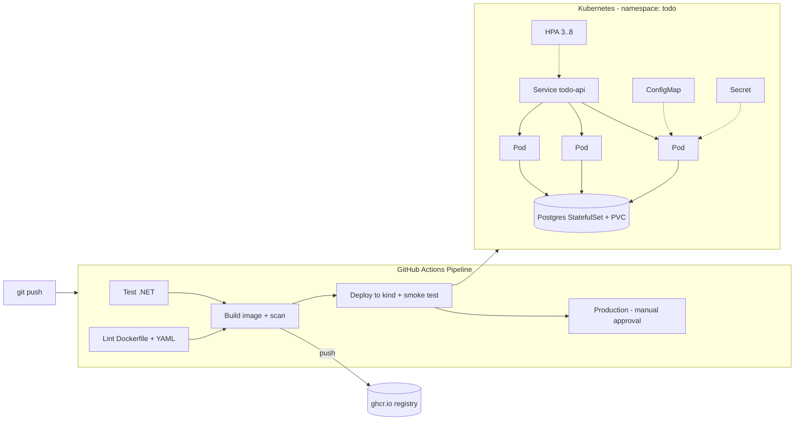

# POC: Pipeline + Docker + Kubernetes (.NET)

مشروع عملي واحد بيغطي المواضيع الثلاثة من البداية للنهاية: API بـ .NET 10 مع PostgreSQL، بيتغلّف بـ **Docker**، وبيشتغل على **Kubernetes**، وبينبني وبيتفحص وبينتشر أوتوماتيكياً بـ **Pipeline** على GitHub Actions.



---

## شو موجود بالمشروع

| الملف | الموضوع | شو بيوضّح |
| --- | --- | --- |
| `src/TodoApi/` | التطبيق | Todo API فيه CRUD، و health checks، وإعدادات من برا الكود |
| `tests/TodoApi.Tests/` | Pipeline | فحوصات بتشتغل أوتوماتيكياً على كل push |
| `Dockerfile` | Docker | multi-stage build، cache للطبقات، مستخدم غير root |
| `.dockerignore` | Docker | ما بنسخ ملفات ما إلها داعي للـ image |
| `compose.yaml` | Docker | التطبيق مع قاعدة البيانات بأمر واحد، و volume و healthcheck |
| `k8s/00-namespace.yaml` | Kubernetes | Namespace |
| `k8s/01-configmap.yaml` | Kubernetes | إعدادات عادية |
| `k8s/02-secret.yaml` | Kubernetes | كلمات السر |
| `k8s/10-postgres.yaml` | Kubernetes | StatefulSet مع PersistentVolumeClaim و headless Service |
| `k8s/20-api-deployment.yaml` | Kubernetes | Deployment فيه 3 نسخ، rolling update، probes، resources، securityContext |
| `k8s/21-api-service.yaml` | Kubernetes | Service بتوزّع الطلبات على الـ Pods |
| `k8s/22-api-hpa.yaml` | Kubernetes | Autoscaling حسب الـ CPU |
| `k8s/23-api-pdb.yaml` | Kubernetes | PodDisruptionBudget |
| `k8s/24-networkpolicy.yaml` | Kubernetes | بس الـ API مسموح يوصل لقاعدة البيانات |
| `k8s/kustomization.yaml` | Kubernetes | تطبيق كل الملفات بأمر واحد |
| `.github/workflows/ci-cd.yml` | Pipeline | test، lint، build، scan، push، deploy، approval |
| `scripts/` | الكل | إنشاء cluster محلي، وسيناريوهات العرض، و smoke test |

### الـ Endpoints

| الطريقة | المسار | الوظيفة |
| --- | --- | --- |
| GET | `/` | معلومات: النسخة، البيئة، رسالة من الـ ConfigMap، واسم الـ Pod اللي رد |
| GET | `/health/live` | هل التطبيق عايش؟ (للـ livenessProbe) |
| GET | `/health/ready` | هل جاهز ومتصل بقاعدة البيانات؟ (للـ readinessProbe) |
| GET / POST | `/api/todos` | عرض المهام / إضافة مهمة |
| GET / PUT / DELETE | `/api/todos/{id}` | مهمة وحدة |
| GET | `/api/stress?seconds=20` | بيضغط الـ CPU عشان تجرّب الـ HPA (للعرض بس) |
| POST | `/api/crash` | بيوقّع التطبيق عشان تجرّب الـ self-healing (للعرض بس) |

---

## المتطلبات

- [.NET 10 SDK](https://dotnet.microsoft.com/download)
- [Docker Desktop](https://www.docker.com/products/docker-desktop/)
- [kind](https://kind.sigs.k8s.io/docs/user/quick-start/#installation) و [kubectl](https://kubernetes.io/docs/tasks/tools/)
- حساب GitHub

> على Windows: شغّل ملفات `scripts/*.sh` من **Git Bash** أو **WSL**. باقي الأوامر بتشتغل بـ PowerShell عادي.

---

## المرحلة 1: التطبيق بدون Docker

```bash
dotnet test TodoPoc.slnx                 # شغّل الفحوصات
dotnet run --project src/TodoApi         # شغّل التطبيق (قاعدة بيانات بالذاكرة)
```
افتح الرابط اللي بيطلع بالـ terminal. لاحظ إنه التطبيق بيقرأ كل إعداداته (connection string، الرسالة) من برا الكود، وهاد اللي رح يخلّينا نستخدم نفس الـ image بكل البيئات.

---

## المرحلة 2: Docker

### 2.1 بناء وتشغيل container واحد
```bash
docker build -t todo-api:1.0 --build-arg APP_VERSION=1.0 .
docker images todo-api                   # شوف حجم الـ image
docker history todo-api:1.0              # شوف الطبقات
docker run -d --name api -p 8080:8080 todo-api:1.0
curl http://localhost:8080/
docker logs api
docker exec -it api sh                   # ادخل جوا الـ container، واكتب whoami (رح تطلع app وليس root)
docker rm -f api
```

**جرّب الـ cache:** عدّل سطر بـ `Program.cs` وابنِ مرة ثانية. رح تلاقي إنه `dotnet restore` ما انعاد (CACHED)، لأنه ملف الـ `.csproj` ما تغيّر.

### 2.2 Docker Compose: التطبيق مع قاعدة البيانات
```bash
docker compose up -d --build
docker compose ps
curl -X POST http://localhost:8080/api/todos -H "Content-Type: application/json" -d '{"title":"from compose"}'
curl http://localhost:8080/api/todos
docker compose logs -f api
```

**جرّب الـ volume:**
```bash
docker compose down          # بيحذف الـ containers
docker compose up -d         # بيرجّعهم
curl http://localhost:8080/api/todos   # البيانات لسا موجودة لأنها محفوظة بالـ volume
docker compose down -v       # هيك بتنحذف البيانات كمان
```

---

## المرحلة 3: Kubernetes (محلياً بـ kind)

```bash
./scripts/kind-up.sh
```
هاد السكربت بيعمل:
1. Cluster فيه 3 nodes (control-plane و 2 workers).
2. بيركّب metrics-server (بيحتاجه الـ HPA).
3. بيبني الـ image وبيحمّلها على الـ nodes.
4. `kubectl apply -k k8s/`
5. بيستنى لحد ما كل شي يصير Ready.

افتح التطبيق:
```bash
kubectl -n todo port-forward svc/todo-api 8080:80
# بعدين افتح http://localhost:8080
```

### أوامر لازم تجربها بإيدك
```bash
kubectl get nodes
kubectl -n todo get pods -o wide              # لاحظ إنه الـ Pods موزعة على nodes مختلفة
kubectl -n todo get deploy,sts,svc,hpa,pvc
kubectl -n todo describe deployment todo-api
kubectl -n todo logs -l app=todo-api --tail=20
kubectl -n todo get endpoints todo-api        # IPs الـ Pods الجاهزة ورا الـ Service
kubectl -n todo exec -it postgres-0 -- psql -U todo -d todos -c 'select * from "Todos";'
```

---

## المرحلة 4: سيناريوهات العرض (لمديرك أو للفريق)

كل سيناريو هو أمر واحد. شغّله وإنت فاتح شاشة ثانية فيها `kubectl -n todo get pods -w`.

| # | الأمر | شو بيصير | المفهوم |
| --- | --- | --- | --- |
| 1 | `./scripts/demo.sh status` | بيعرض كل الموارد | الصورة الكاملة |
| 2 | `./scripts/demo.sh loadbalance` | 10 طلبات بيرد عليهم Pods مختلفة | Service و load balancing |
| 3 | `./scripts/demo.sh selfheal-delete` | بتحذف Pod، فبيطلع واحد جديد بدالها | Deployment و self-healing |
| 4 | `./scripts/demo.sh selfheal-crash` | التطبيق بيوقع، و RESTARTS بيزيد | liveness و restart |
| 5 | `./scripts/demo.sh scale 5` | بتصير 5 نسخ | Scaling |
| 6 | `./scripts/demo.sh config` | بتغيّر الرسالة بدون ما تعيد بناء الـ image | ConfigMap |
| 7 | `./scripts/demo.sh rollout` | نسخة جديدة بتنزل بدون توقف | Rolling update |
| 8 | `./scripts/demo.sh bad-rollout` | image خربانة، والنسخة القديمة بتضل شغالة | maxUnavailable: 0 |
| 9 | `./scripts/demo.sh rollback` | بيرجع للنسخة السابقة | Rollback |
| 10 | `./scripts/demo.sh hpa` | ضغط CPU، فبيزيد عدد الـ Pods تلقائياً (استنى دقيقتين) | HPA |
| 11 | `./scripts/demo.sh persistence` | بتحذف Pod قاعدة البيانات، والبيانات بتضل موجودة | StatefulSet و PVC |
| 12 | `./scripts/demo.sh debug` | describe و logs و endpoints و top | Troubleshooting |

بعد سيناريو الـ HPA شغّل `./scripts/demo.sh hpa-clean`. ولما تخلص كلياً: `./scripts/kind-down.sh`.

---

## المرحلة 5: الـ Pipeline على GitHub

### التجهيز (مرة وحدة)
1. اعمل repository جديد على GitHub وارفع المشروع:
   ```bash
   git init && git add . && git commit -m "POC: pipeline + docker + kubernetes"
   git branch -M main
   git remote add origin https://github.com/<username>/todo-devops-poc.git
   git push -u origin main
   ```
2. من **Settings → Environments** اعمل بيئتين:
   - `test` بدون شروط.
   - `production`، وفعّل عليها **Required reviewers** وحط اسمك. هاي هي الموافقة اليدوية.
3. من **Settings → Branches** أضف حماية على `main`: لازم Pull Request، ولازم الـ checks تنجح قبل الـ merge.

### شو بيصير بكل تشغيل

| المرحلة | Pull Request | Push على main |
| --- | --- | --- |
| Build & test | ✅ | ✅ |
| Lint (hadolint + kubeconform) | ✅ بالتوازي مع الفحوصات | ✅ |
| Build image + فحص ثغرات (Grype) | ✅ | ✅ |
| Push للـ registry (ghcr.io) | ❌ | ✅ |
| Deploy على cluster حقيقي (kind) جوا الـ runner + smoke test | ✅ | ✅ |
| Deploy production | ❌ | ⏸️ بيستنى موافقتك |

### جرّب هدول وإنت بتعرض
- **فحص فاشل بيوقف كل شي:** غيّر بـ `ApiTests.cs` قيمة متوقعة لقيمة غلط، وافتح PR. رح تشوف الـ Pipeline بيفشل والـ merge ممنوع.
- **Build once, deploy many:** لاحظ إنه الـ image بتنبنى مرة وحدة، وبتنتقل كـ artifact لمرحلة الـ deploy بدون ما تنبنى من جديد.
- **التتبع:** الـ tag تبع الـ image هو أول 7 حروف من الـ commit. افتح `/` بالتطبيق، وقيمة `version` بتقلك أي commit شغّال.
- **الموافقة:** بعد الـ merge، مرحلة الـ production بتوقف وبتطلب منك Approve.

> **Production حقيقي:** إذا عندكم cluster، حط محتوى ملف الـ kubeconfig بـ secret اسمه `KUBECONFIG_PRODUCTION` على بيئة production. الـ images على ghcr.io بتكون private افتراضياً، فالـ cluster بيحتاج `imagePullSecret`، أو اعمل الـ package public. بدون الـ secret، المرحلة بتطبع الأوامر اللي كانت رح تتنفذ وبتنجح (وضع POC).

---

## مشاكل شائعة

| المشكلة | السبب | الحل |
| --- | --- | --- |
| `ImagePullBackOff` محلياً | الـ image مش محمّلة على kind | `kind load docker-image todo-api:local --name poc` |
| الـ API بـ `CrashLoopBackOff` بالبداية | قاعدة البيانات لسا بتقلع | التطبيق بيعيد المحاولة 15 مرة. شوف `kubectl -n todo logs -l app=todo-api` |
| `0/1 Ready` | الـ readiness فاشل، يعني ما في اتصال بقاعدة البيانات | `kubectl -n todo logs postgres-0` وتأكد من الـ Secret |
| الـ HPA بيعرض `<unknown>` | metrics-server لسا بيجهز | استنى دقيقة، وجرّب `kubectl top pods -n todo` |
| `port 8080 already in use` | compose أو port-forward ثاني شغّال | `docker compose down` أو سكّر الـ port-forward |
| الـ scan بالـ Pipeline فشل | ثغرة critical بالـ base image وإلها تحديث | ابنِ من جديد عشان تنزل آخر نسخة من `aspnet:10.0` |

---

## الفرق بين الـ POC والـ production الحقيقي

هاد POC للتعلّم والعرض. بمشروع حقيقي رح تغيّر:
- **الـ Secrets:** ما بتنحط بـ Git. استخدم External Secrets Operator أو Sealed Secrets أو Vault.
- **قاعدة البيانات:** غالباً بتكون managed (RDS، Azure Database) بدل StatefulSet.
- **الجداول:** EF Core migrations بـ Job أو بمرحلة بالـ Pipeline، بدل `EnsureCreated`.
- **الـ endpoints `/api/stress` و `/api/crash`:** بتنطفى (`App__EnableChaos: "false"`).
- **الـ Ingress:** فيه HTTPS و cert-manager (شوف `k8s/optional/ingress.yaml`).
- **GitOps:** ممكن تستخدم ArgoCD بدل `kubectl apply` من الـ Pipeline.
- **Helm:** لما يصير عندك أكثر من بيئة، حوّل مجلد `k8s/` لـ Helm chart.
